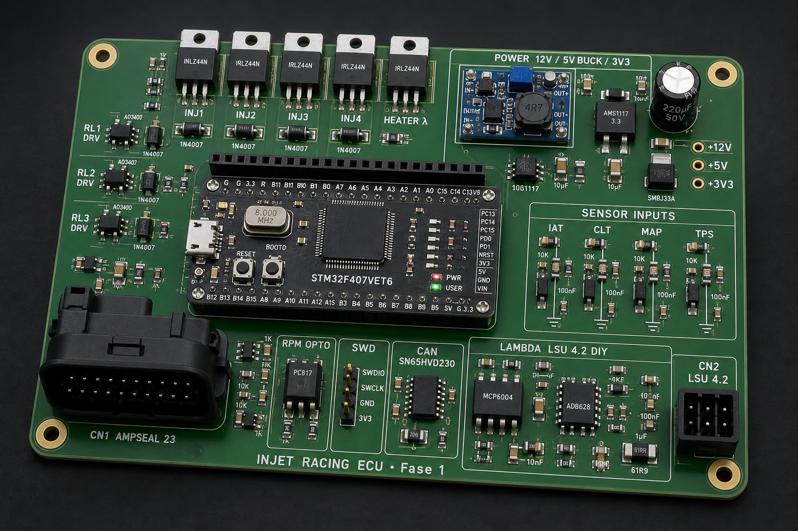
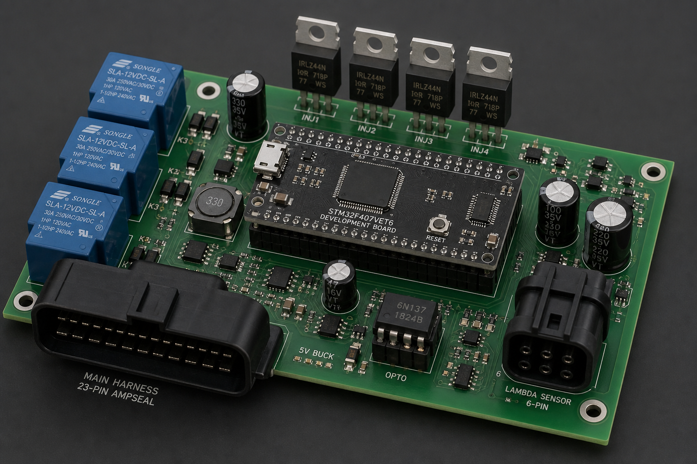
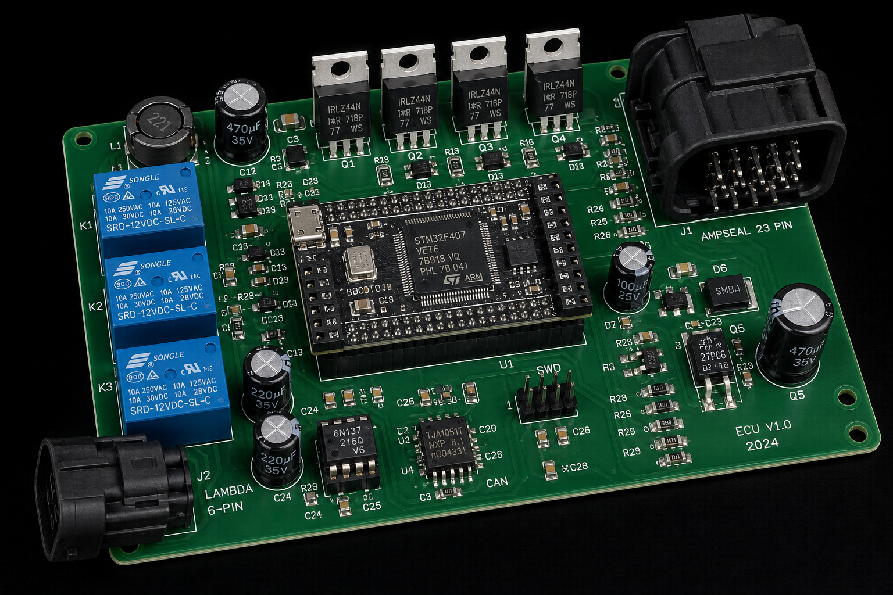
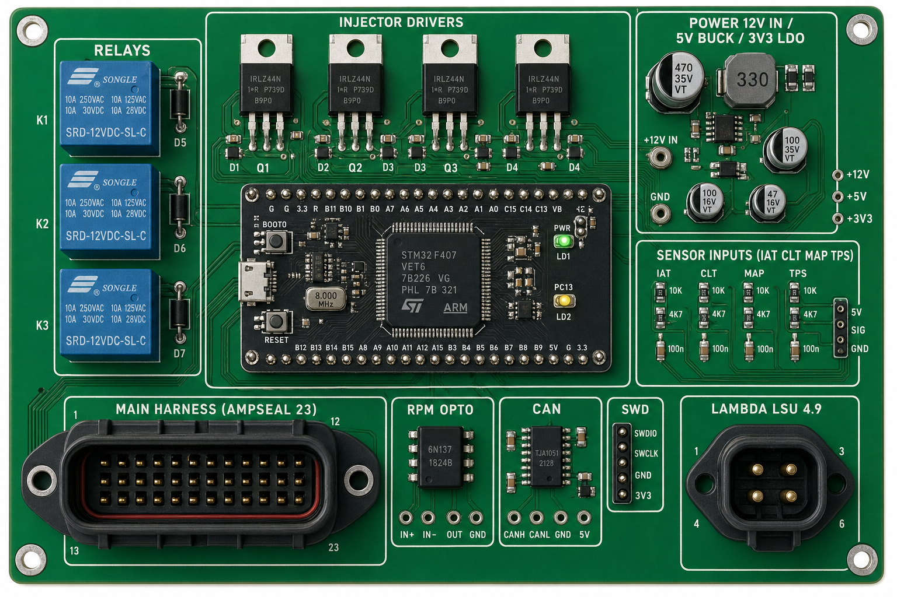
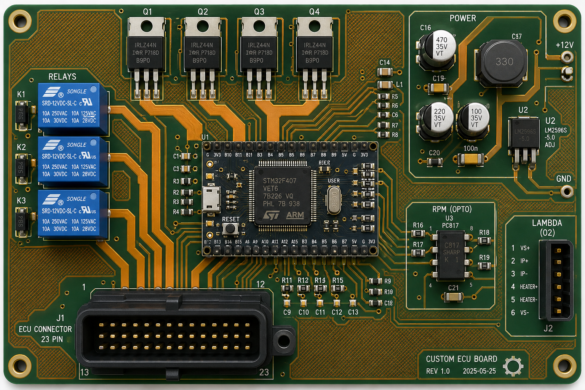
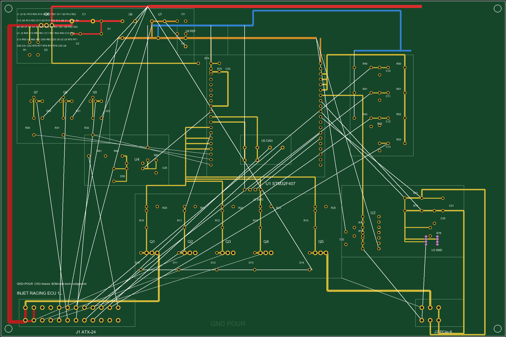
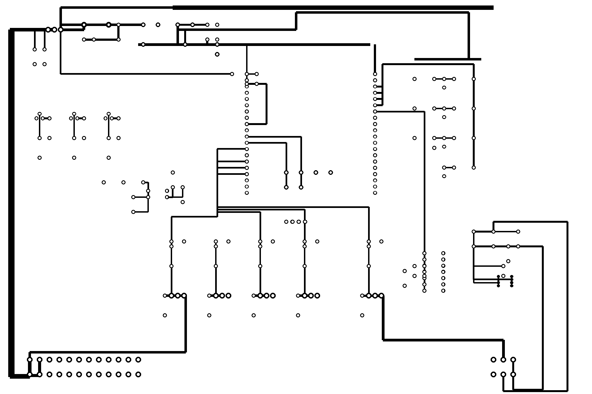

# Esquema Elétrico da ECU — INJET RACING (Fase 1)

> Esquema **por blocos** (nível de circuito/net) da ECU baseada no **STM32F407VET6**.
> Peças em `lista-componentes.md`; adaptação 3,3 V em `00-hardware.md`.
> ⚠️ Este é o esquemático de engenharia (blocos + ligações). O layout roteado (PCB/Gerber)
> é o próximo passo (KiCad) — ver seção 10.

---

## Visão da placa montada (ilustrativa)

> ⚠️ Imagens **conceituais** (render), não são o layout roteado final — servem pra visualizar a
> disposição dos blocos, dos componentes e do roteamento.

Perspectiva 3D — placa montada (**v3**, BOM atual: LSU 4.2 DIY + MCP6002/OPA388IDR):



Perspectiva 3D — placa montada (v1, referência):



Perspectiva 3D — variação com mais detalhe de silkscreen (v2):



Vista de topo com as zonas funcionais anotadas:



Vista de topo mostrando **trilhas de cobre** e roteamento (traços largos para potência,
finos para sinal, *ground pour* visível):



### Proto CNC 1-layer 200×100 mm (fenolite)

> Layout **1-layer sem curto**: no cobre as trilhas **não se cruzam**.
> Sinais entre módulos = **fio no topo** (branco na assembly). CNC usa só o SVG de cobre.
>
> **CN1** = ATX-24 · **CN2** = PCIe-6 · OPA388IDR SMD no lado do cobre.

Vista montagem (cobre colorido + fios brancos TOPO):



Só cobre para CNC (sem fios — **cruzamentos = 0**):



Arquivos: `ecu-pcb-1layer-traces-cnc.svg` · `ecu-pcb-1layer-drc.md` · `ecu-pcb-1layer-netlist.md`

---

## 0. Diagrama de blocos (visão geral)

> **Configuração vigente:** MCU = **Black Board** (módulo comercial) · fonte **na placa ECU** (12 V → buck 5 V).

```
        +12V bateria
             │
      ┌──────▼───────┐
      │  PROTEÇÃO     │
      │  ENTRADA      │
      │ (fusível,     │
      │  IRF9540-P,   │
      │  TVS, bulk)   │
      └──────┬────────┘
             │ +12V_PROT
     ┌───────▼──────┐
     │ BUCK MP1584  │──────────────────────────────► +5V  (MAP, op-amps λ, pin 5V Black Board)
     └───────┬──────┘
             │
             │  ┌─────────────────────────────────────────────────────────────┐
             │  │  BLACK BOARD (STM32F407VET6)                                │
             │  │  pin 5V ◄── +5V do buck                                     │
             │  │  [LDO interno AMS1117]                                      │
             │  │  pin 3V3 ──► barra +3V3_EC (distribui na fenolite)          │
             │  │  GND ◄──► GND comum                                         │
             │  │  PA0–PA6, PC1, PB0, PB8/9, PE9–14, PD8–12 ──► drivers/CAN  │
             │  └─────────────────────────────────────────────────────────────┘
             │
      Sensores ◄── CN1 (IAT CLT MAP TPS RPM bicos relés CAN)
      Lambda  ◄── CN2 PCIe-6
```

**Resposta rápida sobre +3,3 V:** a placa ECU **não monta outro LDO** — mas **sim distribui +3V3** numa barra de cobre/fio (tirada do pino **3V3** da Black Board), com caps locais, até o CN1, TPS, NTC, CAN e opto RPM. Ver **§1.3** e **§1.4**.

---

## 1. Proteção de entrada + alimentação (12 V)

```
 +12V(bat) o──[FUSE 5-7,5A]──┬───────────────┬──────────────────► +12V_PROT (rede interna)
                             │               │
                        (S)  │           [C_bulk]  100-470µF/50V
      Q_rev  ┌─────────────┐ │               │  + [C 100nF]
   MOSFET-P  │ D  ── S      │─┘               │
   (reversa) │      │  G    │                 │
             └──────┼───────┘                GND
                    │
            [R_g 100k]──┬── G
                        │
                   [Zener 15V] (protege gate)
                        │
                       GND

  +12V_PROT ──[TVS load dump ~26-33V p/ GND]   (absorve pico)
```

- **MOSFET-P** = proteção contra inversão de bateria (conduz só na polaridade certa).
- **R_g + Zener** protegem o gate do MOSFET-P.
- **TVS** grampeia o *load dump* automotivo. **C_bulk** segura a tensão em transientes.

### 1.1 Buck 5 V (módulo MP1584 — Fase 1)

```
 +12V_PROT ──[C_in 100µF+100nF]── VIN+ ┌─────────────────┐ VOUT+ ──[C_out 220µF+100nF]──► +5V
                                       │  MÓDULO MP1584  │         │
                                       │  (ajustar p/     │         ├──► alim. MAP (CN1 pino 6)
                                       │   5,00 V c/     │         ├──► +5V op-amps λ (§7)
                                       │   multímetro)   │         └──► pin **5V** da Black Board
                                       └────────┬────────┘
                                               GND ──► GND comum
```

> **USB Black Board (regra INJET RACING):** **gravar firmware** = ECU **sem 12 V**, USB normal · **monitor/tune** = ECU **com 12 V**, cabo com **power blocker** (sem VBUS). No carro: sem USB.

### 1.2 ~~LDO 3,3 V na placa ECU~~ → **dentro da Black Board**

```
 +5V (buck) ──► pin 5V da Black Board ──► [LDO interno] ──► pin 3V3 da Black Board
                                                      │
                                                      └──► STM32 VDD/VDDA (já no módulo)
```

- **Não soldar AMS1117 extra** na fenolite — evita dois reguladores brigando na mesma barra.
- O LDO da Black Board aguenta ~800 mA; consumo típico da ECU em +3V3 ≈ 50–150 mA → folga.

### 1.3 Módulo MCU — Black Board (U1)

```
                    ┌────────────────── BLACK BOARD ──────────────────┐
                    │  STM32F407VET6 + HSE 8 MHz + USB + NRST/BOOT0   │
                    │                                                  │
  +5V (buck) ──────►│  5V  (alimentação principal)                     │
  GND comum ◄──────►│  GND                                             │
                    │  3V3 ─────────────────────────────► +3V3_EC (§1.4)│
                    │                                                  │
  REF3033 3,3V ────►│  VDDA / VREF+  (fio fino, curto — §1.5)         │
                    │                                                  │
  Sensores/drivers  │  GPIO (headers 2,54 mm):                         │
  (ver tabela §2)   │  PA0 PA1 PA2 PA3 PA4 PA5 PA6                   │
                    │  PC1 PB0 PB8 PB9 PE9 PE11 PE13 PE15             │
                    │  PD8 PD9 PD10 PD12 PC0                          │
                    │                                                  │
  (bancada)         │  USB ─ gravação / debug                          │
  (opcional)        │  SWDIO SWCLK ─ ST-Link se USB falhar             │
                    └──────────────────────────────────────────────────┘
```

**Montagem:** encaixar a Black Board na fenolite com **headers fêmea** (ou parafusos espaçadores).
Trilhas de **GND** e **+5V** largas; fios de **sinal** curtos na zona analógica.

### 1.4 Barra +3V3 na placa ECU (distribuição — **obrigatório**)

> A fonte **gera** o 3,3 V na Black Board; a placa ECU **distribui** pros circuitos periféricos.

```
 pin 3V3 (Black Board) ──┬──[C_bulk 10µF]──[C 100nF]──► +3V3_EC (estrela na fenolite)
                         │
                         ├──► pull-ups NTC IAT/CLT (§3.1)
                         ├──► alim. cursor TPS (§3.3) ──► CN1 pino 7
                         ├──► pull-up opto RPM R3 4k7 (§4)
                         ├──► SN65HVD230 VCC (§8)
                         └──► (não ligar REF3033 em paralelo com esta barra — §1.5)
```

| Consumidor +3V3 | Corrente típica |
|---|---|
| Pull-ups 2× NTC + TPS | < 5 mA |
| PC817 + R 4k7 | < 2 mA |
| SN65HVD230 | < 50 mA |
| **Total periféricos** | **< 100 mA** (LDO Black Board aguenta) |

**Caps na barra +3V3_EC:** 1× **10 µF** + 1× **100 nF** perto do ponto onde o fio sai da Black Board;
mais **100 nF** junto ao SN65 e junto à zona analógica (star ground).

### 1.5 Referência ADC REF3033 (separada do +3V3 lógica)

```
 REF3033 OUT (3,300 V) ──► VDDA / VREF+ da Black Board (pino exposto no header analógico)
 REF3033 GND ──► AGND (unir com GND só no ponto estrela, perto do MCU)
 +3V3_EC ──► REF3033 VIN (alimentação do chip ref.)
```

> REF3033 **não substitui** o +3V3 lógico — é referência de **precisão** pros ADC Ip/Un/lambda.
> Se não achar pino VDDA acessível, o firmware funciona com VREF = 3,3 V interno (menos preciso).

### 1.6 Redes de alimentação (resumo)

| Rede | Origem | Alimenta |
|---|---|---|
| **+12V_PROT** | Bateria pós proteção | Bicos, relés, aquecedor λ, divisor VBat |
| **+5V** | Buck MP1584 | MAP, MCP6002/OPA388IDR, **pin 5V Black Board** |
| **+3V3_EC** | **Pin 3V3 Black Board** (distribuída) | TPS, NTC pull-ups, opto, CAN transceiver, CN1 pino 7 |
| **+3V3_MCU** | LDO interno Black Board | STM32 (não expor carga pesada neste pino) |
| **GND** | Comum | Star ground: 1 ponto entre power GND e signal GND |

### 1.7 Orçamento de corrente — bicos × +5 V × faixa +12 V

> **Regra:** os **bicos não usam +5 V**. Low-side em **+12 V**; a placa só chaveia o **negativo**
> (CN1-13…16 → IRLZ44N → GND). O buck **+5 V** alimenta MAP, op-amps λ e pin **5V** da Black Board.

#### 1.7.1 Onde circula a corrente dos bicos

```
+12V (CN1-1/2, chicote motor) ──► bico (+) ──► bico (−) ──► CN1-13..16 ──► Q10–Q13 ──► GND
```

| Trecho | Corrente (4 bicos ON, batch-fire) | Quem dimensiona |
|---|---|---|
| **Chicote +12 V → bico (+)** | até **~4 A** pico (4× ~1 A @ 12 Ω) | fio do motor — **fora da placa** |
| Trilhas **INJ1–INJ4** (CN1 → dreno Q) | **~1 A** por canal | PCB prodv6 — min **1,2–2,0 mm** |
| Retorno **GND** (4 canais juntos) | até **~4 A** pico | zone GND + star ground |
| Barra **+12V_PROT** onboard | **não** leva o + dos bicos | só buck, λ, relés, flyback |

Flyback (D10–D13, catodo → +12V_PROT): picos curtos no desligamento — não é carga contínua.

#### 1.7.2 Bico Bosch 0280156086 (firmware `fuel.cpp`)

| Parâmetro | Valor |
|---|---|
| Resistência bobina | **12 Ω** |
| Corrente @ 12 V (contínua) | **~1 A** / bico |
| 4 bicos simultâneos (batch-fire) | **~4 A** pico · duty baixo (ms) |
| Largura de pulso típica | 2–15 ms (RPM/carga) |

#### 1.7.3 Rede +5 V (MP1584) — independente dos bicos

| Consumidor | Corrente típica |
|---|---|
| Black Board (STM32 + LDO interno) | 100–200 mA @ +5 V |
| MAP + MCP6002 / OPA388IDR | 30–50 mA |
| **Total ECU @ +5 V** | **~150–300 mA** |
| MP1584 (módulo) | até **~3 A** saída |

Abrir os 4 bicos **não aumenta** a corrente do +5 V. Sag no +12 V (chicote/bateria) pode ser visto no
ADC VBat — caps **C1/C5** (220 µF) amortechem na placa.

#### 1.7.4 Cargas na faixa +12 V (dentro da ECU)

Corrente que passa por **F1 → Q1 (IRF9540) → +12V_PROT**:

| Carga | Corrente típica | Corrente pico / nota |
|---|---|---|
| Buck MP1584 (entrada) | 150–350 mA | ~0,5 A transiente |
| Aquecedor λ LSU 4.2 (CN2-1) | 0,6–1,2 A (PWM) | até **~2 A** aquecimento a frio |
| Bobinas relé ×3 (SRD externo, COM onboard) | 30–70 mA cada | **~0,2–0,4 A** se 3 ON |
| Divisor VBat (R14) | < 0,2 mA | desprezível |
| **Soma ECU @ +12V_PROT** | ~1–2 A | **~2,5–3 A** pico (λ quente + relés) |

**Bicos:** o **+** vem do chicote; corrente principal **não** percorre o barramento +12V_PROT — só
retorno chaveado (INJ → GND) e flyback.

#### 1.7.5 Pontos que podem sobrecarregar

| Ponto | Risco | Mitigação |
|---|---|---|
| **F1 (5 A)** | Pico **chicote**: 4 A bicos + λ ~2 A + relés ~0,3 A se coincidirem | Fusível **7,5 A** no carro (§1); bancada: fonte **≥5 A** p/ teste 4 bicos |
| **Chicote +12 V → bicos** | Único gargalo real dos 4 bicos juntos | Fio **≥1,0 mm²** (16 AWG) no ramal comum dos bicos |
| **CN1-1/2 (+12V_BAT)** | Entrada da placa — alimenta ECU, não substitui chicote dos bicos | Ramo dedicado bicos no conector de injeção do motor |
| **Q1 IRF9540** | Toda corrente **ECU** @ 12 V | OK até ~5 A cont. (TO-220); aquecer = revisar conexão |
| **Q20–Q22 (2N7000) relés** | Id máx. **~200 mA**/canal | SRD-12V ~30–70 mA OK; relé pesado → **`implementacoes-futuras/FUT-02-rele-driver-irlz44n.md`** |
| **Q30 (aquecedor λ)** | IRLZ44N — OK p/ ~2 A | Flyback D30 obrigatório |
| **Trilha +12V_PROT → CN2-1** | Aquecedor até ~2 A | PCB prodv6 min **2,0 mm** — OK |
| **Trilhas INJ1–4** | ~1 A/canal | min **1,2–2,0 mm** — OK (`python _analyze_widths.py`) |
| **Retorno GND (4 INJ)** | até ~4 A pico | Zone GND contínua; evitar slot entre MOD8 e conector |

**Verificação PCB:** `kicad/prodv6/_analyze_widths.py` — potência/carga sem trecho abaixo da regra.

#### 1.7.6 Cenário pior caso (referência)

| Evento | Corrente aprox. | Onde mede |
|---|---|---|
| 4 bicos ON (batch-fire) | ~4 A | chicote +12 V · trilhas INJ · GND |
| λ aquecendo (PWM 100 %) | ~1–2 A | CN2-1 · +12V_PROT |
| 3 relés ON | ~0,2–0,4 A | +12V_PROT → bobina externa |
| ECU lógica (buck) | ~0,2 A | +12V_PROT → U2 IN+ |

Coincidência **4 bicos + λ frio + 3 relés** → **>5 A** no chicote/bateria — fusível **5 A** pode abrir;
trilhas INJ/GND e MOSFETs aguentam; **+5 V não entra nessa conta**.

---

## 2. Black Board — mapa de ligações (GPIO → circuito)

> Cristal 8 MHz, decoupling VDD, NRST e BOOT0 **já estão na Black Board** — não remontar (ver §2.1 só como referência).

### 2.0 Tabela fio-a-fio (header Black Board → fenolite ECU)

| Pino BB | Função FW | Liga para | Observação |
|---|---|---|---|
| **5V** | alim. | **+5V** do buck MP1584 | tensão estável 5,00 V |
| **3V3** | alim. saída | **+3V3_EC** barra §1.4 | **não** é entrada — é saída do LDO interno |
| **GND** | terra | GND comum (estrela) | vários pinos GND — usar todos |
| PD0 | IAT | divisor NTC §3.1 | ADC (L12O) |
| PA9 | CLT | divisor NTC §3.1 | ADC (L16O) |
| PC9 | MAP | divisor §3.2 | ADC (L17O) |
| PC8 | TPS | cursor pote §3.3 | ADC (L18I; L18O=PC7 trilha) |
| PA8 | VBat | divisor 100k/10k §3.4 | ADC (L17I; L20 trilha) |
| PA4 | DAC Vm | buffer MCP6002 §7 | **DAC out** (R13I) |
| PA5 | Ip λ | shunt 61R9 §7 | ADC (R13O) |
| PA6 | Un λ | filtro Nernst §7 | ADC (R14I) |
| PE2 | Ri pulse | GPIO pulso R_ESR §7 | saída (R5I) |
| **PE8** | RPM | coletor PC817 §4 | EXTI falling (R17O) |
| PB8 | CAN RX | SN65 RX §8 | |
| PB9 | CAN TX | SN65 TX §8 | |
| PE9 | INJ1 | gate IRLZ44N §5 | R18I |
| PE11 | INJ2 | gate IRLZ44N §5 | R19I |
| PE13 | INJ3 | gate IRLZ44N §5 | R20I |
| PE15 | INJ4 | gate IRLZ44N §5 | R21I |
| PD10 | RL main | gate 2N7000 §6 | L22I GRL1 |
| PD8 | RL pump | gate 2N7000 §6 | L23I GRL2 |
| PD9 | RL IAC | gate 2N7000 §6 | L22O GRL3 |
| PB0 | Heater λ | gate IRLZ44N §7 | PWM (R16I) |
| VDDA/VREF+ | ref. ADC | REF3033 §1.5 | fio curto, blindado se possível |

### 2.1 Esquema de potência completo (uma folha)

```
  BAT+ ──[FUSE]──[IRF9540]──[TVS]── +12V_PROT ──┬── bicos / relés / heater H+
                                                 │
                                                 ├──[100k]──┬── PC1 (VBat)
                                                 │        [10k]── GND
                                                 │
                                    ┌────────────▼────────────┐
                                    │     MP1584  12V → 5V    │
                                    └────────────┬────────────┘
                                                 │ +5V
                    ┌────────────────────────────┼────────────────────┐
                    │                            │                    │
                 [MAP]                      [MCP6002/OPA388IDR]    pin 5V ──► BLACK BOARD
              CN1 pino 6                                                         │
                                                                                 ▼
                                                                          [LDO interno]
                                                                                 │
                    ┌──────────────────────────────────────────────────────────┤ +3V3
                    │                                                          │
              +3V3_EC ◄──[10µF+100nF]── pull-ups NTC/TPS, PC817, SN65, CN1 p7 │
                    │                                                          │
              PA0–PA6, PC1, PB0… ◄── fios sinal ──► drivers §5–§7, CAN §8      │
                    │                                                          │
              REF3033 ──────────────────────────► VDDA/VREF+ (precisão ADC)    │
                    └──────────────────────────────────────────────────────────┘
                                    GND comum (estrela)
```

---

## 2A. STM32F407 — suporte mínimo (só se chip solto; ❌ não é seu caso)

> **Com Black Board, pule esta seção.** Mantida como referência para PCB futuro com chip SMD.

```
        +3V3 ──┬── VDD (vários) cada um com [100nF] p/ GND  + [4,7µF bulk]
               │
               ├── VDDA ──[ferrite bead]──┬── VDDA_pin  + [1µF + 10nF] p/ GND
               │                          │
               │                     VREF+ ┘  (ou referência de precisão REF3033)
               │
   NRST ──[100nF p/ GND]
   BOOT0 ──[10k p/ GND]        (roda da flash)
   VBAT ── se NÃO usa RTC: curtar em +3V3.
           se usa RTC: pilha CR2032 (via diodo) + cap 100nF.
           NUNCA deixar VBAT flutuando.

   SWD (gravar/debug):  SWDIO · SWCLK · GND · +3V3  → header CN3 (4 vias) ou USB da Black Board
```

### 2A.1 Cristal principal HSE (8 MHz) — na Black Board

Gera o clock preciso do sistema. Sem ele o STM32 usa o RC interno (±1–2%, ruim para CAN/RPM/USB).

```
                        ┌───────── STM32F407VET6 ─────────┐
                        │                                 │
    ┌─── OSC_IN  (PH0) ─┤                                 │
    │                   │                                 │
   ═══ [C1 22pF]        │       oscilador interno         │
    │                   │       amplifica o cristal       │
   GND                  │                                 │
                        │                                 │
   ┌─┤├─┐               │                                 │
   │XTAL │  8 MHz       │                                 │
   │HC49 │              │                                 │
   └─┤├─┘               │                                 │
    │                   │                                 │
   ═══ [C2 22pF]        │                                 │
    │                   │                                 │
   GND                  │                                 │
    │                   │                                 │
    └─── OSC_OUT (PH1) ─┤                                 │
                        └─────────────────────────────────┘
```

- **XTAL:** cristal 8,000 MHz — **já soldado na Black Board**.

### 2A.2 Cristal RTC LSE (32,768 kHz) — opcional

Clock separado para o relógio de calendário (data/hora). Serve para timestamp em logs. **Se não vai usar RTC, omitir os dois pinos ficam livres.**

```
                        ┌───────── STM32F407VET6 ─────────┐
                        │                                 │
    ┌── PC14 (OSC32_IN)─┤                                 │
    │                   │                                 │
   ═══ [C3 6-12pF]      │                                 │
    │                   │                                 │
   GND                  │                                 │
                        │                                 │
   ┌─┤├─┐               │                                 │
   │XTAL │ 32,768 kHz   │                                 │
   │ (cilindro)         │                                 │
   └─┤├─┘               │                                 │
    │                   │                                 │
   ═══ [C4 6-12pF]      │                                 │
    │                   │                                 │
   GND                  │                                 │
    │                   │                                 │
    └── PC15(OSC32_OUT)─┤                                 │
                        └─────────────────────────────────┘
```

- **XTAL:** 32,768 kHz (formato cilíndrico pequeno tipo "grão de arroz").
- **C3 = C4 = 6–12 pF** (bem menores que os do HSE).
- Se não usar, **NÃO precisa** montar — deixar PC14/PC15 como GPIO comum.

---

## 3. Entradas dos sensores (ADC, 3,3 V)

> Detalhe dos divisores/pull-ups em `00-hardware.md` §3-4. Cada entrada leva **100 nF** p/ GND.

### 3.1 NTC — IAT e CLT (pull-up p/ +3,3 V)
```
 +3V3 ──[R_pullup 2,26k]──┬──► ADC (IAT = PA0 / CLT = PA1)
                          │
                       [ NTC ] (vem do sensor via CN1)
                          │
                         GND
        + [100nF] do ADC p/ GND
```

### 3.2 MAP — 0–5 V (precisa divisor → 3,3 V)
```
 sensor MAP (0–5V, CN1) ──[R1 10k]──┬──► ADC (MAP = PA2)
                                    │
                                  [R2 18k]
                                    │
                                   GND
        + [100nF] do ADC p/ GND
   Alimentação do MAP: +5V e GND (via CN1)
```

### 3.3 TPS — potenciômetro alimentado em 3,3 V (sem divisor)
```
 +3V3 ── term.A do pote (CN1)
 GND  ── term.B do pote (CN1)
 cursor (0–3,3V, CN1) ──► ADC (TPS = PA3)   + [100nF] p/ GND
```

### 3.4 VBat — tensão da bateria (divisor → 3,3 V)

> Usado pelo firmware para **dead-time** dos bicos (`04-bicos-injetores.md` §7).
> Divisor 11:1 → ~14,4 V bateria = ~1,31 V no ADC (dentro de 0–3,3 V).

```
 +12V_PROT ──[R1 100k 1%]──┬──► ADC (VBAT = PC1)
                          │
                        [R2 10k 1%]
                          │
                         GND
        + [100nF] do ADC p/ GND
        + [BAT54S] clamp (opcional, recomendado)
```

- **Fórmula FW:** `Vbat = Vadc × (R1 + R2) / R2` → com 100k/10k: `Vbat ≈ Vadc × 11`

### 3.5 Pinagem analógica fixada (STM32F407)

Sensores no **header J2 esquerdo** da Black Board (fileiras 12 / 16–18):

| Pino | Função | Pad U1 | Tipo |
|---|---|---|---|
| **PD0** | IAT | L12O | ADC in |
| **PA9** | CLT | L16O | ADC in |
| **PC9** | MAP | L17O | ADC in |
| **PC8** | TPS | L18I | ADC in (L18O trilha PC7) |
| **PA8** | VBat | L17I | ADC in (L20 trilha PD13/14) |
| **PA4** | **DAC1 Vm** (lambda terra virtual) | R13I | **DAC out** |
| **PA5** | **Ip** (shunt lambda) | R13O | ADC in |
| **PA6** | **Un** (Nernst lambda) | R14I | ADC in |

> λ é **calculado no firmware** a partir de Ip — PA4 **não** é entrada ADC.

---

## 4. Condicionador de RPM (negativo da bobina) — isolado por opto

```
 COIL(-) o(CN1)─[R1 10k 2W]─[R2 10k 2W]─┬─(A)  LED  (K)─o GND
                                        │   PC817
                                   [D1 1N4148]        (fototransistor)
                                   (protege LED)       C │ E
                                                         │ │
             +3V3 ──[R3 4k7]──┬──────────────────────────┘ │
                              │                            GND
                              └──► GPIO c/ interrupção (RPM = PE8 / R17O, borda de descida)
                              │
                            [C1 1nF] p/ GND (filtra ringing)
```

- Saída **invertida**: repouso = 3,3 V; faísca = pulso p/ 0 V → tratar como **falling edge**.

---

## 5. Drivers dos bicos injetores (low-side, 4x)

```
 +12V_PROT ──► (bico +)  [INJETOR 12Ω]  (bico -) ─┬──► Dreno Q_inj (IRLZ44N)
                                                  │
                             [D_flyback 1N4007]───┘ (catodo p/ +12V)  *ou clamp zener*
   GPIO (PE9/PE11/PE13/PE15) ──[R_gate 100Ω]── Gate Q_inj
                                               Source ── GND_power
   + [R_gs 10k] p/ GND no gate (mantém MOSFET off durante reset do MCU)
```

- 4 canais iguais (batch-fire pode acionar em 1–2 grupos).
- **Por canal:** 1× IRLZ44N + 1× R_gate 100 Ω + 1× R_gs 10 kΩ (pull-down) + 1× 1N4007 flyback.
- **Diodo/clamp de flyback obrigatório** por bico — sem ele o MOSFET queima no desligamento.
- Saída de cada bico vai ao **CN1** (lado do injetor no chicote).

---

## 6. Drivers de relé (3,3 V → bobina 12 V, 3x)

```
 +12V_PROT ──► [BOBINA RELÉ 12V] ─┬──► Dreno Q_rele (2N7002/AO3400/IRLZ44N)
                                  │
                     [D_flyback 1N4007]  (catodo p/ +12V)
                                  │
 GPIO (PD8/PD9/PD10) ─[R 1k]─ Gate │
                                  Source ── GND_power
   Contatos do relé (COM/NO) ──► carga via **CN3** (PCIe-6 dedicado)
```

- **RL1** principal (auto-hold), **RL2** bomba (corte por RPM), **RL3** IAC/aux.

---

## 7. Sonda lambda banda larga DIY (LSU 4.2 padrão · 4.9 opcional)

> **Sem CJ125.** Controlador = STM32 (PID) + op-amps (topologia rusEFI / `mck1117/wideband`).
> Detalhe: **`06-sonda-lambda.md`** · Firmware: **`firmware/`**.
> Padrão: **LSU 4.2 (0258007351)**. Alternativa: **LSU 4.9 (0258017025)** — ver §7.2.

```
                         ┌─────────────── CONDICIONAMENTO (op-amps) ───────────────┐
  +5V ──[100nF+10µF]────►│ MCP6002 (dual DIP-8) + OPA388IDR (zero-drift Ip)         │
                         │                                                          │
  PA4 DAC ──────────────►│ Vm (terra virtual ~2,5 V) ── buffer MCP6002 ────────────►│─► CN2 VM
  OPA388IDR + shunt ────►│ drive corrente de bomba (Ip)                           │
                         │                                                          │
  LSU Ip ◄── CN2 ────────┤──[Rshunt 61,9Ω]── medida Ip ──► ADC **PA5**              │
  LSU Un ◄── CN2 ────────┤──[R78 1k][C31 220n]── Nernst ──► ADC **PA6**             │
  LSU RT ◄── CN2 ────────┤── Rcal (interno na sonda)                                 │
                         │                                                          │
  GPIO ── pulso Ri ──────┤──[R_ESR*]── Un (mede Ri / temperatura)                   │
                         │   * R_ESR = **6k8** (LSU 4.2)  ou  22k (LSU 4.9)         │
                         │                                                          │
  REF3033 ───────────────┤── VREF+ ADC (recomendado p/ Ip/Un)                       │
  R76/R77 10k ───────────┤── bias buffer Vm                                         │
                         └──────────────────────────────────────────────────────────┘

  Aquecedor:
  +12V_PROT ──[fuse 3-5A]──► H+ (CN2)
  GPIO PWM ──[R 100Ω]── Gate Q_heater (IRLZ44N) ── H- (CN2)
                         Source ── GND_power  + R_gs 10k
```

### 7.1 Funções no firmware (STM32F407)

| Malha | Entrada | Saída | Alvo |
|---|---|---|---|
| Aquecedor | Ri (pulso Nernst) | PWM MOSFET | **~300 Ω** (4.9) ou **~80 Ω** (4.2) @ ~780 °C |
| Corrente bomba | Un ≈ 450 mV | DAC → Ip | Un estabilizado → Ip ∝ λ |
| Leitura λ | Ip (queda no shunt) | tabela Ip→λ | malha fechada combustível |

### 7.2 LSU 4.2 (padrão) vs LSU 4.9 (opcional)

| Item | LSU 4.2 (padrão) | LSU 4.9 (opcional) |
|---|---|---|
| P/N | **0258007351** / 0258007057 | **0258017025** |
| Conector CN2 placa | **PCIe 6 pinos** | PCIe 6 pinos |
| Conector sonda | **1J0973733** | **1928404687** |
| R_ESR (pulso Ri) | **6,8 kΩ** | **22 kΩ** |
| Ri alvo | ~**80 Ω** | ~**300 Ω** |
| Calibração FW | **free-air** obrigatório | Rcal interno |
| Referência | ar interno (pode contaminar) | elétrica (mais estável) |

> Hardware base (MCP6002, OPA388IDR, shunt 61R9, MOSFET, REF3033) é **o mesmo**. Só muda R_ESR, conector sonda e config no firmware.

### 7.3 Passivos op-amp (BOM detalhado)

| Ref | Valor | Função |
|---|---|---|
| U2 MCP6002 | dual DIP-8 | buffer Vm, filtros |
| U3 OPA388IDR | zero-drift SMD | malha corrente Ip |
| U8 REF3033 | 3,3 V | referência ADC |
| R70 | 61,9 Ω 1% | shunt Ip |
| R71 | 6,8 kΩ 1% | R_ESR (4.2) |
| R76, R77 | 10 kΩ | bias buffer Vm |
| R78 | 1 kΩ | série entrada OPA388IDR |
| C30, C31 | 220 nF | filtros Ip / Un |
| C32 | 100 nF + 10 µF | decoupling +5 V |

### 7.4 CN2 — sinais

| Sinal | Função |
|---|---|
| **IP** | corrente de bomba (via shunt) |
| **VM** | terra virtual (DAC) |
| **UN** | célula Nernst |
| **RT / Rcal** | resistor calibração (no conector) |
| **H+** | aquecedor +12 V |
| **H−** | aquecedor (dreno MOSFET) |

---

## 8. CAN (comunicação — painel/telemetria)

```
 STM32 CAN1_TX (PB9) ──► ┌──────────────┐ ── CANH ──► CN1 (pino 18)
 STM32 CAN1_RX (PB8) ◄── │ TRANSCEIVER  │ ── CANL ──► CN1 (pino 19)
                         │ SN65HVD230   │
      +3V3 ──[100nF+10µF]│    (3,3V)    │  + [R 120Ω terminação — só ponta de barramento]
                         └──────┬───────┘  + [TVS PESD1CAN em CANH/CANL — opcional]
                               GND
```

- O STM32 tem o **controlador** CAN, mas o barramento físico exige um **transceiver** (chip externo).
- **SN65HVD230** casa direto com 3,3 V do STM32 (recomendado). TJA1050 seria alternativa em 5 V (precisa resistor no TX).
- **Terminação 120 Ω** só nas duas pontas físicas do barramento CAN (não em cada nó).

---

## 9. Conectores / chicote

### 9.1 CN1 — Conector principal **ATX 24 pinos** (placa-mãe ↔ fonte)

> Mesmo conector da **placa-mãe de PC** que recebe a fonte ATX. Na PCB: header macho 2×12 (passo 4,20 mm).
> Pinagem abaixo é **remapeada para a ECU** (não usar cores/funções ATX de PC).

| Pino | Sinal ECU | Tipo |
|---|---|---|
| 1 | +12V pós-chave (acorda a ECU) | alim. |
| 2 | +12V permanente (bateria) | alim. |
| 3 | +5V saída (MAP) | alim. sensor |
| 4 | +3V3 saída (TPS / pull-ups NTC) | alim. sensor |
| 5 | GND sinal (sensores) | terra |
| 6 | IAT sinal | ADC in |
| 7 | CLT sinal | ADC in |
| 8 | MAP sinal | ADC in |
| 9 | GND potência | terra |
| 10 | TPS sinal | ADC in |
| 11 | +12V_PROT (divisor VBat) | alim. |
| 12 | NC (relé RL3 — CN3) | — |
| 13 | Bico INJ1 (low-side) | saída |
| 14 | Bico INJ2 (low-side) | saída |
| 15 | Bico INJ3 (low-side) | saída |
| 16 | Bico INJ4 (low-side) | saída |
| 17 | Sinal de partida/arranque (opcional) | in |
| 18 | Saída tacômetro (opcional) | saída |
| 19 | Shield / dreno de blindagem | terra |
| 20 | CAN H | comum |
| 21 | CAN L | comum |
| 22 | RPM (negativo da bobina) | in |
| 23 | NC (relé RL1 — CN3) | — |
| 24 | NC (relé RL2 — CN3) | — |

Buscar: `conector ATX 24 pinos placa mae` / `header ATX 24 pin PCB`.

### 9.2 CN2 — Sonda lambda **PCIe 6 pinos** (placa de vídeo)

> Mesmo conector **6 pinos de alimentação de GPU**. 5 pinos usados (LSU 4.2); 1 NC.
> Rcal da LSU 4.2 fica no chicote original da sonda — não precisa de 6º sinal na ECU.

| Pino PCIe-6 | Sinal LSU 4.2 | Ligação na ECU |
|---|---|---|
| 1 | **H+** | +12V_PROT (aquecedor) |
| 2 | **H−** | dreno MOSFET aquecedor (PWM) |
| 3 | **IP** | shunt 61R9 → ADC Ip + OPA388IDR |
| 4 | **VM** | terra virtual (DAC + buffer MCP6002) |
| 5 | **UN** | Nernst + R_ESR 6k8 → ADC |
| 6 | NC | sem ligação |

Buscar: `conector PCI-E 6 pinos placa` / `header PCIe 6 pin PCB`.

### 9.3 CN3 — Relés **PCIe 6 pinos** (igual mecânico CN2)

> Conector dedicado ao **chicote de cargas** (bomba / principal / IAC). Mesmo footprint PCIe-6 da GPU.
> **COM** dos SRD = +12V_PROT **on-board** (RL pin3) — chicote leva só os **NO**.

| Pino | Net | Carga (NO SRD) |
|---|---|---|
| 1 | **RL_IAC** | relé IAC/aux |
| 2 | **RL_PUMP** | relé bomba |
| 3 | **RL_MAIN** | relé principal |
| 4 | **GND** | referência chicote |
| 5 | NC | — |
| 6 | NC | — |

**PCB prodv6:** @ `(215.74, 121.10)` rot 0° — ao lado MOD8/relés.

> **Estratégia:** **CN1 ATX-24** (chicote motor/sensores) + **CN2 PCIe-6** (lambda) + **CN3 PCIe-6** (relés). Gravação: USB/SWD na Black Board (sem conector na ECU).

---

## 10. Próximo passo (PCB)

- [x] MCU = **Black Board** módulo encaixado (não chip SMD direto na Fase 1)
- [x] Fonte ECU = **buck MP1584** onboard; **+3V3 distribuído** da Black Board (sem AMS1117 extra)
- [x] Esquemático **KiCad** hierárquico → `kicad/injet-racing-ecu.kicad_pro` (9 folhas)
- [x] **ProdV6 PCB** — rotas MOD3–12 · `kicad/prodv6/injet-racing-prodv6.kicad_pcb` (2026-08-10)
- [ ] Gerar Gerber + BOM + posição (pick&place) — após Edge.Cuts + DRC layout
- [ ] Bancada: `kicad/prodv6/BENCH-CHECKLIST.md`
